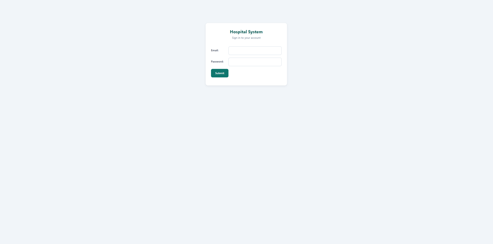
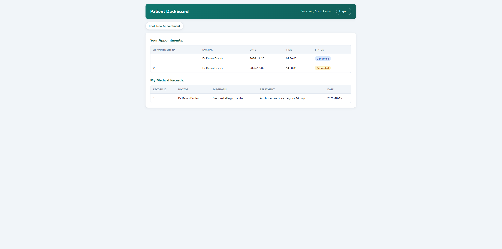
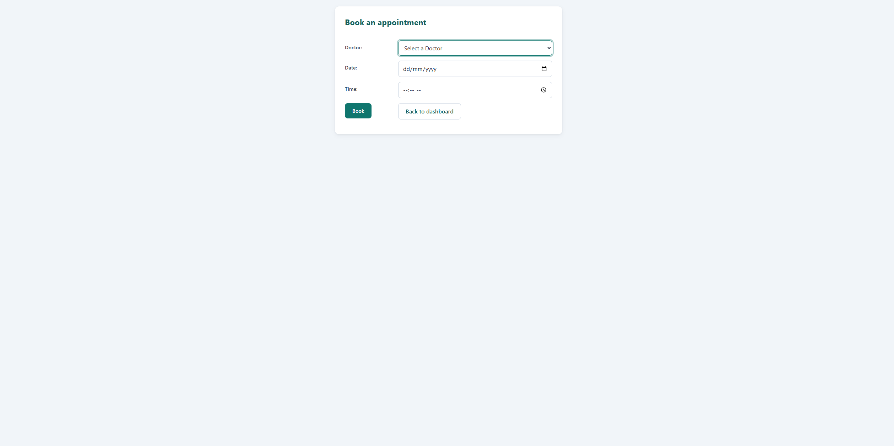
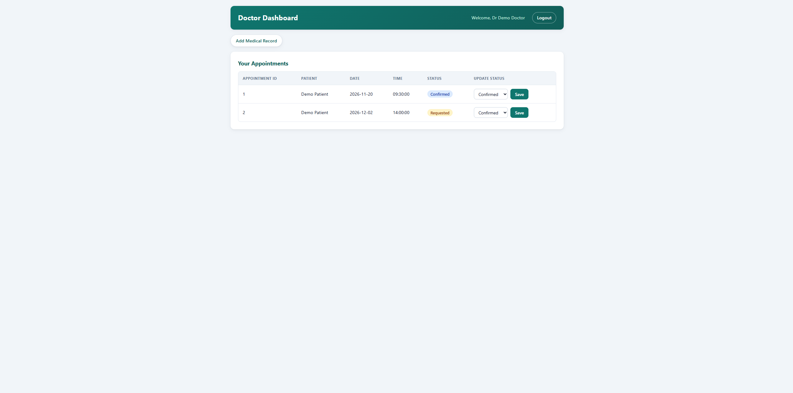
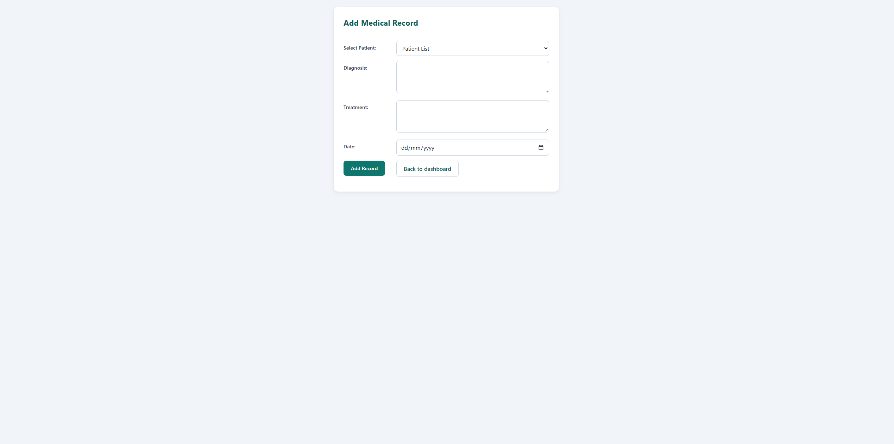
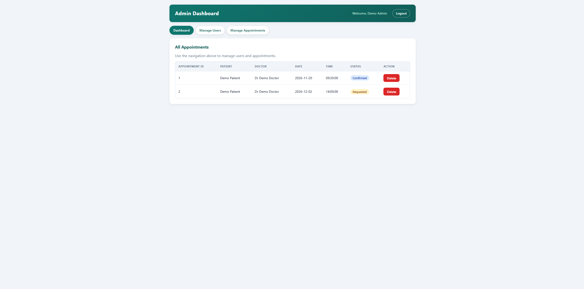
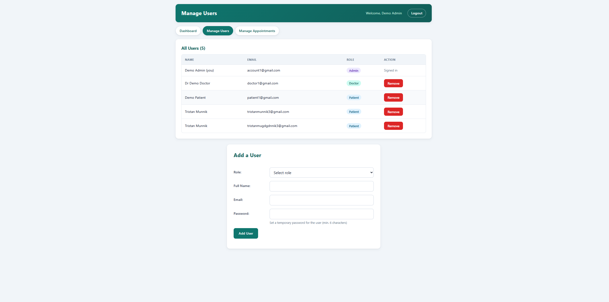
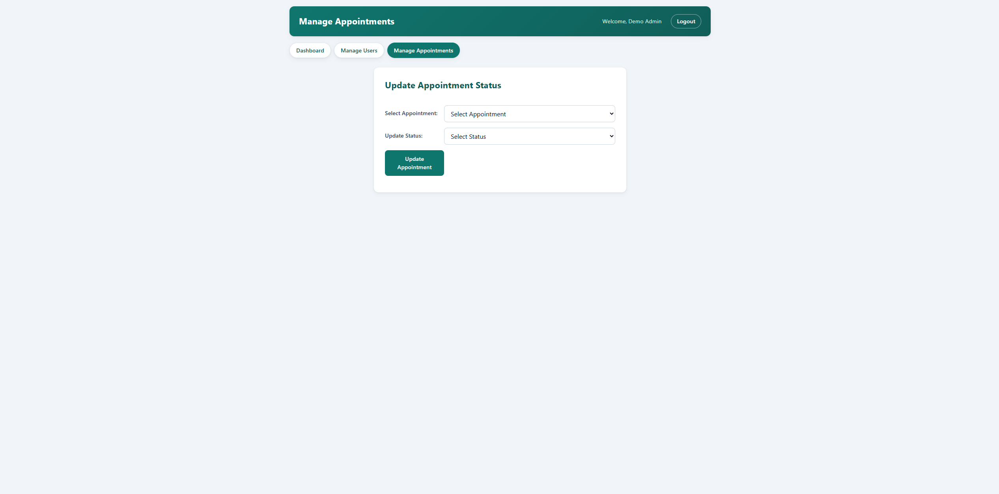

# Hospital System

A role-based hospital management web app built with PHP and MySQL. Patients book appointments and view their medical records, doctors manage their schedule and write records, and admins manage users and appointments.

## Features

| Role    | What they can do |
|---------|------------------|
| Patient | Book appointments with a doctor, view their appointments and medical records |
| Doctor  | View their appointments, confirm / complete / cancel them, add medical records for patients |
| Admin   | Add and remove patients, doctors and other admins; update appointment status; delete appointments |

## Screenshots

### Login


### Patient
| Dashboard | Book an appointment |
|-----------|---------------------|
|  |  |

### Doctor
| Dashboard (update appointment status) | Add a medical record |
|---------------------------------------|----------------------|
|  |  |

### Admin
| Dashboard | Manage users |
|-----------|--------------|
|  |  |



## Tech and security decisions

- **PHP 8 + PDO + MySQL** with prepared statements for every query (no SQL injection)
- **Passwords hashed** with `password_hash` / `password_verify` (bcrypt)
- **Role-based access control** via a single `require_role()` helper
- **CSRF tokens** on every form that changes data
- **Output escaping** (`e()` helper) on all user-supplied data to prevent XSS
- **Session ID regenerated on login** to prevent session fixation
- **Ownership checks on the server**: a doctor can only change their own appointments, and an admin cannot remove their own account
- **Post/Redirect/Get** after form submissions so refreshing the page never resubmits a form
- Only `public/` is meant to be web-accessible; config and shared code live in `src/`

## Project structure

```
public/            Web root (the only folder the server should expose)
  index.php        Redirects to the right dashboard or login
  login.php, logout.php
  patient/         dashboard.php, book-appointment.php
  doctor/          dashboard.php, medical-records.php
  admin/           dashboard.php, users.php, appointments.php
  assets/          css/ and js/
src/               Shared code, not web-accessible
  bootstrap.php    Session, role map, helpers, CSRF, flash messages, role checks
  partials/        Shared page fragments (document head, dashboard header and nav)
  config.example.php
database/
  schema.sql       Tables for the app
docs/              Screenshots used in this README
```

## Setup

Requires PHP 8.1+, MySQL 8+ and Node (only used to run the npm scripts; there are no npm dependencies).

1. Create the database: `npm run db:setup`
2. Copy `src/config.example.php` to `src/config.php` and enter your database credentials
3. Create the first admin account (instructions at the bottom of `database/schema.sql`)
4. Start the app: `npm run dev`
5. Open http://localhost:8000 and log in

## Roadmap

- [x] Screenshots
- [ ] Automated tests
- [ ] Live demo
